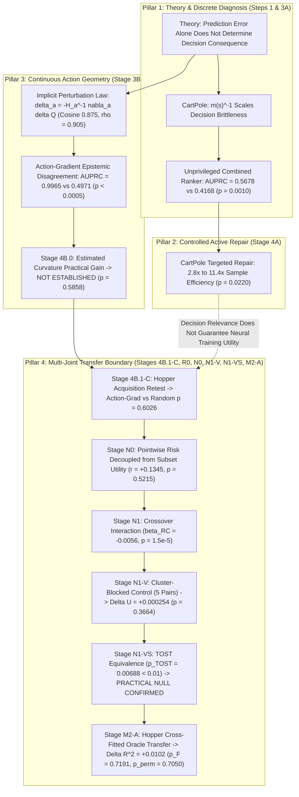

# Master Causal & Evidence Map: Decision Boundaries in Model-Based RL

**Canonical Project Title:** *From Decision Relevance to Learning Utility: Operator-Conditional Limits of World-Model Error Prioritization*  
**Short Title:** *Decision Relevance Is Not Learning Utility in Neural World Models*  
**Milestone:** Final Scientific Consolidation & Evidence Lock  
**Date:** 2026-08-20  
**Author:** Pham Quang Minh  
**Status:** **ALL BENCHMARKS FULLY CLOSED & AUDITED -> EXPERIMENTAL PROGRAM 100% COMPLETE & FROZEN**

---

## 1. The Three Canonical Scientific Boundaries

$$\boxed{
\begin{aligned}
\textbf{Boundary 1: }& \text{Prediction error magnitude alone does not determine decision risk.} \\
\textbf{Boundary 2: }& \text{Decision risk is not sufficient to predict marginal training utility} \\
&\text{under the tested Hopper repair operator after regional controls.} \\
\textbf{Boundary 3: }& \text{Static initial-point gradient influence is not sufficient to predict} \\
&\text{650-step Adam utility in the tested Hopper neural-world-model regime.}
\end{aligned}
}$$

```
+-------------------------------------------------------------------------------------------------------------------+
| Level              | Core Mathematical / Empirical Object   | Validated Domain    | Empirical Status              |
+-------------------------------------------------------------------------------------------------------------------+
| 1. Theory          | Prediction Error != Control Damage     | Tabular MDP         | PROVEN (Theorems Verified)    |
| 2. Discrete Risk   | Action-Margin Vulnerability (m^-1)     | CartPole Continuous | PROVEN (AUPRC 0.57 vs 0.42)   |
| 3. Discrete Repair | Low-D Targeted World-Model Acquisition | CartPole Continuous | PROVEN (2.8x-11.4x over Rand) |
| 4. Continuous Geom | Implicit Perturbation Law (delta_a)   | Continuous CartPole | PROVEN (Cosine 0.87, rho 0.90)|
| 5. Continuous Risk | Action-Gradient Epistemic Disagreement | Continuous CartPole | PROVEN (AUPRC 0.9965, p<1e-4) |
| 6. Curvature Score | Deployed Estimated Curvature Gain     | Continuous CartPole | NOT ESTABLISHED (p = 0.5858)  |
| 7. MBRL Transfer   | Hopper-v4 Active Acquisition (B=200)   | Hopper-v4 (MuJoCo)  | NEGATIVE TRANSFER (p = 0.6026)|
| 8. Utility Gap     | Pointwise Risk -> Set Training Utility | Hopper-v4 (MuJoCo)  | EQUIVALENT TO NULL (TOST p<0.01)|
| 9. Oracle Transfer | Static Gradient Influence on Hopper    | Hopper-v4 (MuJoCo)  | FALSIFIED (Delta R^2 p=0.7191)|
+-------------------------------------------------------------------------------------------------------------------+
```

---

## 2. Complete Causal Pathway & Experimental Evidence Flowchart



---

## 3. Granular Stage-by-Stage Evidence Ledger

### Pillar 1: Mathematical Theory & Discrete Risk Ranking
* **Step 1 (Theorems):** Prediction error magnitude alone does not determine decision consequence on Tabular MDPs. Vulnerability scales inversely with margin $m(s) = |Q(s, a_1) - Q(s, a_2)|$.
* **Stage 3A (CartPole Continuous):**
  * Held-Out Test Set: $N = 1,881$ states, natural flip prevalence $= 1.97\%$ ($37$ flips).
  * Unprivileged Combined Ranker achieved $\text{AUPRC} = \mathbf{0.5678} \ [0.4355, 0.7343]$ ($28.8\times$ over base rate $0.0197$) vs Action Disagreement comparator $\text{AUPRC} = 0.4168$ ($\Delta = \mathbf{+0.1510}, \mathbf{p = 0.0010}$).
  * Captures **$89.2\%$ of true flips** at $10\%$ budget ($p = 0.0020$). Full permutation null $p_{\mathrm{perm}} = 0.004975$.
  * Margin sensitivity verified on $H_{\mathrm{vote}}=0$ unanimous subpopulation ($\text{AUPRC} = 0.2042$ vs $0.0087$).

---

### Pillar 2: Targeted World-Model Repair in Controlled Domains
* **Stage 4A (CartPole Continuous Active Acquisition):**
  * Candidate Pool: $N = 1,612$ ($26$ flips), Held-Out Test: $N = 1,444$ ($17$ flips).
  * At $B = 5\%$ ($81$ queries): Combined Ranker achieves $-16.5\%$ flip reduction ($\eta = 0.0346$, **$2.8\times$ over Random** $\eta = 0.0123$).
  * At $B = 10\%$ ($161$ queries): Combined Ranker achieves $-12.9\%$ flip reduction ($\eta = 0.0137$, **$11.4\times$ over Random** $\eta = 0.0012$). Confirmatory 10-seed paired gain $+0.0093$ flips/query ($t(9) = 2.764, \mathbf{p = 0.0220}$).

---

### Pillar 3: Continuous Action Geometry & Perturbation Law
* **Stage 3B (Continuous CartPole LQR Geometry):**
  * First-order displacement: $\delta a \approx - H_a^{-1} \nabla_a \delta Q(s, a^*)$. Decision regret: $R_{\mathrm{dec}}(s) \approx \frac{1}{2} g(s)^\top (-H_a)^{-1} g(s)$.
  * Flatness amplification: $5.04\times$ larger displacement in flat vs sharp optima ($p = 2.56 \times 10^{-90}$).
  * Perturbation law verified: $99.9\%$ sign match, $\cos = 0.8747$, Spearman $\rho = 0.9048$ ($p < 10^{-5}$), median relative error $5.82\%$.
  * Held-out test ranking: Action-Gradient Disagreement $\sigma_{\nabla_a Q}$ achieves $\text{AUPRC} = \mathbf{0.9965}$ vs Dynamics $\text{AUPRC} = 0.4971$ ($\Delta = +0.5038, p_{\mathrm{boot}} < 0.0005$).
* **Stage 4B.0 (Curvature Closure Pre-Gate):**
  * Practical regret comparison post-repair: $S_{\mathrm{cont}}$ vs $\sigma_{\nabla_a Q}$ paired $p = 0.5858$. Curvature contribution not established in deployed score; canonical score frozen to $\sigma_{\nabla_a Q}$.

---

### Pillar 4: Multi-Joint MBRL Transfer Boundary & Diagnostic-to-Utility Gap
* **Stage R0 & R0-V (Optimization Validity Closure on Hopper-v4):**
  * Demonstrated that one-shot retraining degradation was an optimization schedule artifact ($M_0$ under-convergence / transient gradient shocks). Normalized converged operator eliminates degradation ($0.0638 \to 0.0604, -5.39\%, p = 3.61 \times 10^{-4}$).
* **Stage 4B.1-C (Operator-Normalized Acquisition Re-Test on Hopper-v4, $N = 10$ Seeds):**
  * Under standardized, non-degrading operator, Action-Gradient Disagreement ($H=5 = 0.062742$) and Random Acquisition ($H=5 = 0.061980$) show no statistically detectable difference ($\text{Paired } \Delta = +0.000761, t = 0.539, \mathbf{p = 0.6026}$).
* **Stage N0 (Diagnostic-to-Utility Gap Falsification, $T_{\mathrm{steps}} = 650$):**
  * Budget sweep (H1-FC) confirms no simple threshold under fixed compute.
  * Spatial cluster stratification (H2) improves over raw top-risk ($0.057010$ vs $0.059212, p = 0.0020$).
  * Subset aggregate risk mass (H3) has no detectable linear association with training utility ($r = +0.1345, p = 0.5215$).
* **Stage N1, N1-V, & N1-VS (Cluster-Blocked Validity Closure):**
  * Stage N1 observed crossover interaction ($\beta_{RC} = -0.0056, p < 10^{-5}$) between risk and coverage.
  * Stage N1-V occupancy audit exposed that the HR/LC advantage was confounded by Clusters 4 and 0 holding **$42.1\%$ of the entire evaluation distribution**.
  * When cluster identities are held strictly constant across 5 distinct pairs ($N = 25$ runs), the risk effect collapses to $\Delta U = \mathbf{+0.000254} \ (t = 0.921, \mathbf{p = 0.3664})$.
  * Stage N1-VS confirms **TOST Equivalence**: effects outside $\pm 0.001000$ are statistically incompatible with the empirical data at the chosen equivalence level ($p_{\mathrm{TOST}} = 0.00688 < 0.01$).
  * Leave-one-pair-out sensitivity confirms that $P_1$ (C4+C0) materially drives the small positive residual; omitting $P_1$ drops $\Delta U$ to $-0.000038$ ($p = 0.8996$).
* **Stage M0 & M1 (Local Operator Geometry on Controlled 2D Dynamics):**
  * Verified that local single-step substitution utility is strictly governed by incremental gradient alignment $\hat{U}_{\mathrm{sub}}^{(1)} = \eta g_E^\top \delta g_S$ ($\rho_s = +0.9993, p < 10^{-8}$, Wilcoxon $W = 55.0, p < 0.001$).
  * Operator-consistent additive null matches realized batch utility to within $< 4.3 \times 10^{-9}$ error.
* **Stage M2-A (Hopper Privileged Oracle Transfer):**
  * Strict 5-fold trajectory cross-fitting demonstrates that static initial-point gradient influence $I_{\mathrm{sub}}(\theta_0)$ adds essentially zero incremental explanatory value beyond $(R + C)$ ($\Delta R^2 = +\mathbf{0.0102}, F = 0.142, \mathbf{p = 0.7191}, \text{Permutation } \mathbf{p_{\mathrm{perm}} = 0.7050}$).
  * Paired contrast correlation $\Delta I_{sp}$ vs $\Delta U_{sp}$ is $r = \mathbf{+0.0594} \ (p = 0.9245)$.
  * Interpretation: Local initial gradient influence does not extrapolate across 650 steps of multi-batch Adam ensemble optimization.

---

## 4. Final Scientific Conclusion

$$\boxed{
\begin{aligned}
&\text{1. Prediction error alone does not determine decision consequence.} \\
&\text{2. Decision-sensitive geometry can diagnose vulnerable errors.} \\
&\text{3. Such diagnostics can improve targeted repair in controlled regimes.} \\
&\text{4. But decision relevance does not by itself guarantee neural training utility.} \\
&\text{5. In Hopper, regional coverage explains substantially more acquisition utility} \\
&\quad\text{than the tested pointwise decision-risk score.} \\
&\text{6. Static initial-point gradient influence is not sufficient to predict long-horizon neural ensemble utility.}
\end{aligned}
}$$


