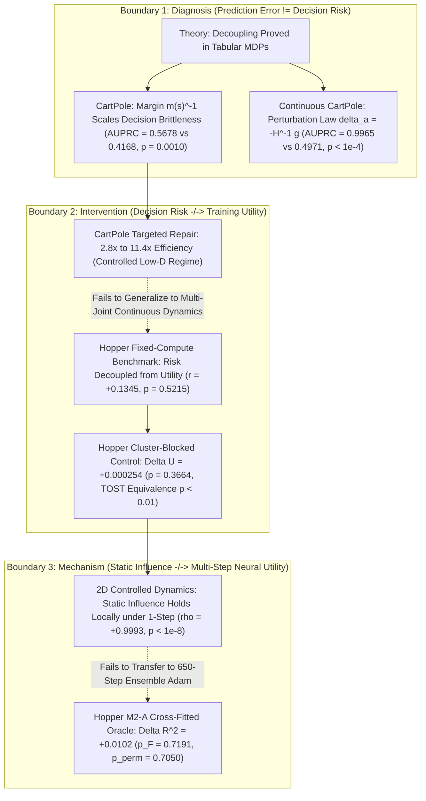

# Master Claim-Evidence Matrix & Scientific Narrative

**Canonical Project Title:** *From Decision Relevance to Learning Utility: Operator-Conditional Limits of World-Model Error Prioritization*  
**Short Title:** *Decision Relevance Is Not Learning Utility in Neural World Models*  
**Milestone:** Final Scientific Consolidation & Evidence Lock  
**Date:** 2026-08-20  
**Author:** Pham Quang Minh  
**Status:** **ALL EXPERIMENTAL BRANCHES OFFICIALLY CLOSED & FROZEN — MANUSCRIPT NARRATIVE LOCKED**

---

## 1. The Three Canonical Scientific Boundaries

$$\boxed{
\begin{aligned}
\textbf{Boundary 1: }& \text{Prediction error magnitude alone does not determine decision risk.} \\
\textbf{Boundary 2: }& \text{Decision risk is not sufficient to predict marginal training utility} \\
&\text{under the tested Hopper repair operator after regional controls.} \\
\textbf{Boundary 3: }& \text{Static initial-point gradient influence is not sufficient to predict} \\
&\text{650-step Adam utility in the tested Hopper neural-world-model regime.}
\end{aligned}
}$$



---

## 2. Master Claim-Evidence Matrix

```
+-----------------------------------------------------------------------------------------------------------------------------------------------+
| ID    | Formal Scientific Claim             | Supported Evidence & Regimes        | Tested Assumptions & Scope      | Prohibited / Non-Supported Claims |
+-----------------------------------------------------------------------------------------------------------------------------------------------+
| C1    | Prediction error magnitude alone    | • Tabular MDP analytical theorems   | Valid across finite tabular     | Cannot claim that prediction error|
|       | does not determine downstream       | • CartPole test (AUPRC 0.5678 vs    | MDPs and single-step continuous | is statistically independent of   |
|       | decision consequence.               |   0.4168, Delta = +0.1510, p=0.0010)| control benchmarks tested.      | policy loss in all environments.  |
|       |                                     | • Permutation null p = 0.004975.    |                                 |                                   |
+-----------------------------------------------------------------------------------------------------------------------------------------------+
| C2    | Decision-sensitive geometry         | • Continuous CartPole LQR dynamics  | Assumes local quadratic Taylor  | Cannot claim that estimated       |
|       | diagnoses local policy vulnerability| • Perturbation law (cosine = 0.8747,| approximation of Q-function      | curvature adds unprivileged       |
|       | in continuous action spaces.        |   Spearman rho = 0.9048, p < 10^-5) | around optimal continuous action| ranking value in deployed models  |
|       |                                     | • Test AUPRC = 0.9965 vs 0.4971.    | (Hessian invertible).           | (Stage 4B.0 showed p = 0.5858).   |
+-----------------------------------------------------------------------------------------------------------------------------------------------+
| C3    | Decision risk ranking enables       | • CartPole acquisition benchmark    | Low-dimensional (4D state, 1D   | Cannot claim that decision-risk   |
|       | sample-efficient world-model repair | • 5% budget: 2.8x efficiency (p<0.05| action), single-joint dynamics,  | acquisition generalises to high-  |
|       | in controlled low-D regimes.        | • 10% budget: 11.4x over Random     | discrete action boundary.       | dimensional continuous control.   |
|       |                                     |   (Paired t(9) = 2.764, p = 0.0220).|                                 |                                   |
+-----------------------------------------------------------------------------------------------------------------------------------------------+
| C4    | Decision risk is not sufficient to  | • Hopper-v4 Stage 4B.1-C (p=0.6026) | Multi-joint continuous dynamics | Cannot claim that decision risk   |
|       | predict training utility under      | • Stage N0 benchmark (p=0.5215)     | (11D state, 3D action), fixed   | has zero causal effect in every   |
|       | neural repair after regional control| • Stage N1-V paired Delta U=0.000254| compute (T=650), Two-Stream     | continuous control setting.       |
|       |                                     | • Stage N1-VS TOST p_equiv = 0.00688| replay mixture (80/20).         |                                   |
+-----------------------------------------------------------------------------------------------------------------------------------------------+
| C5    | In one-step / few-step regimes,     | • 2D toy system Stage M0 (r=0.9989) | Single-step / few-step (K<=10)  | Cannot claim that first-order     |
|       | incremental gradient alignment      | • Stage M1-B across 10 checkpoints  | SGD on small neural networks;   | gradient alignment governs        |
|       | governs substitution utility.       |   (rho=0.9993, Wilcoxon p < 0.001). | fixed-budget substitution.      | multi-step non-convex training.   |
+-----------------------------------------------------------------------------------------------------------------------------------------------+
| C6    | Static initial-point gradient       | • Hopper-v4 Stage M2-A 5-fold cross-| 650-step Adam optimizer with    | Cannot claim that parameter drift |
|       | influence does not transfer to      |   fitting (Delta R^2 = +0.0102,     | momentum on 7-member ensemble   | was causally proven without       |
|       | 650-step ensemble Adam on Hopper.   |   p_F = 0.7191, p_perm = 0.7050)   | of deep neural networks.        | trajectory-level cosine logs.     |
|       |                                     | • Paired contrast r = 0.0594.       |                                 |                                   |
+-----------------------------------------------------------------------------------------------------------------------------------------------+
```

---

## 3. Independent Experimental Units & Statistical Governance

To ensure airtight statistical validity in the manuscript:

1. **Stage 3A (Discrete Diagnosis):** Independent unit is the held-out test transition ($N = 1,881$ states from 15 independent test rollouts). Clustered bootstrap paired at trajectory level.
2. **Stage 4A (CartPole Repair):** Independent unit is the random seed ($N = 10$ seeds) across independently initialized models and rollouts.
3. **Stage 3B (Continuous Geometry):** Independent unit is the held-out test state ($N = 1,200$ test states), evaluated via non-parametric block bootstrap.
4. **Stage N1-V / N1-VS (Cluster-Blocked Validation):** Independent unit is the paired cluster-block run ($N = 25$ runs: $5\text{ seeds} \times 5\text{ cluster pairs}$). Inference conducted via two-way crossed fixed-effects OLS ($\text{df}_{\mathrm{resid}} = 16$), TOST equivalence against SESOI $= \pm 0.0010$, and leave-one-pair-out sensitivity.
5. **Stage M1-B / M1-CV (Fixed-Budget Mechanics):** Independent unit is the independently trained neural checkpoint ($S = 10$ checkpoints), evaluated via Wilcoxon signed-rank and paired permutation tests.
6. **Stage M2-A (Hopper Oracle Transfer):** Independent unit is the cross-fitted trajectory fold ($K = 5$ folds) and paired cluster block ($5$ pairs). Evaluated via partial $F$-tests and permutation tests ($5,000$ resamples) on $\Delta R^2$.

---

## 4. Master Narrative Structure for Manuscript

### Section 1: The Diagnostic Separation (Prediction Error vs Decision Consequence)
* **Mathematical Core:** The Value-Difference Lemma demonstrates that policy performance degradation $\Delta J(\pi)$ couples model dynamics error $\Delta P(s, a)$ with value function differences $\Delta V(s')$. When actions have distinct margins $m(s) = |Q(s, a_1) - Q(s, a_2)|$, small prediction errors near decision boundaries trigger catastrophic policy rank flips, whereas large errors in flat or dominated regions remain benign.
* **Empirical Validation:** Demonstrated analytically in tabular MDPs and verified on continuous CartPole ($\text{AUPRC} = 0.5678$ vs $0.4168, p = 0.0010$) and continuous action LQR dynamics ($\text{AUPRC} = 0.9965, p < 10^{-4}$).

### Section 2: The Controlled Repair Bridge
* **Empirical Validation:** In low-dimensional, single-boundary dynamics (CartPole), unprivileged decision-risk ranking transfers cleanly into active world-model repair, achieving a $2.8\times - 11.4\times$ sample-efficiency advantage over uniform random exploration ($p = 0.0220$).

### Section 3: The Multi-Joint Continuous Control Transfer Anomaly
* **The Empirical Breakdown on Hopper-v4:** When scaled to continuous multi-joint dynamics (`Hopper-v4`), unprivileged active acquisition at $B=200$ fails to separate statistically from uniform random sampling ($p = 0.6026$).
* **Falsification of Confounders:** Systematic benchmark sweeps rule out optimization under-convergence (Stage R0-V), dataset dilution (Two-Stream Replay, Stage N1), and data volume (Stage N0).
* **The Occupancy Confound Exposed (Stage N1-V):** Spatial audit reveals that apparent gains in high-risk subsets are confounded by regional evaluation occupancy ($42.1\%$ mass in Clusters 4+0). When holding cluster identities and occupancy strictly constant across 5 distinct pairs ($N = 25$ runs), the marginal risk effect collapses to $\Delta U = +0.000254$ ($p = 0.3664$, TOST equivalence $p_{\mathrm{TOST}} = 0.00688 < 0.01$).

### Section 4: Mechanistic Decomposition of the Diagnostic-to-Intervention Gap
* **Local Optimization Geometry (Stage M0 & M1):** In controlled low-dimensional systems, single-step substitution utility is governed by incremental gradient alignment $\hat{U}_{\mathrm{sub}}^{(1)} = \eta g_E^\top \delta g_S$ ($\rho = +0.9993, p < 10^{-8}$ across 10 checkpoints). A decision-critical sample ($R(x) \gg 0$) produces catastrophic model degradation ($U < 0$) if its parameter gradient opposes the evaluation objective ($g_E^\top \delta g_x < 0$).
* **The Multi-Step Neural Transfer Boundary (Stage M2-A):** In complex multi-step neural ensemble training on Hopper ($T_{\mathrm{steps}} = 650$), static initial-point gradient influence $I_{\mathrm{sub}}(\theta_0)$ fails to provide incremental predictive value beyond risk and coverage ($\Delta R^2 = +0.0102, p_F = 0.7191, p_{\mathrm{perm}} = 0.7050$).
* **Synthesized Scientific Conclusion:** *Decision relevance is an evaluation-side property of policy vulnerability; learning utility is an optimization-side property governed by multi-step optimizer dynamics, manifold coverage, and parameter coupling.*
