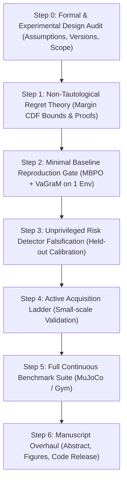

# Upgrading Decision-Boundary Geometry in MBRL to Q1 Journal Standards: Audited Research Blueprint & Execution Protocol

**Manuscript:** *Decision-Boundary Geometry of World-Model Errors in Reinforcement Learning*  
**Target Venues:** IEEE TPAMI / JMLR / IEEE T-NNLS / Top-tier AI Conferences (NeurIPS / ICML / ICLR)  
**Status:** Methodologically Audited & Gated Execution Plan  

---

## 1. Gated Roadmap Overview

To prevent running weeks of experiments on fragile formulations, execution proceeds strictly through gated validation stages:

---

## 2. Step 0: Design Audit & Experimental Lock-ins

### 2.1 Benchmark Versions & Environment Semantics
* **MuJoCo & Environment Suite:** Pin strictly to `Gymnasium` (e.g. `InvertedPendulum-v5`, `Reacher-v5`, `HalfCheetah-v5`, `Hopper-v5`) or legacy v4 with pinned physics engine (`mujoco==3.x.x`), explicit termination semantics (`terminate_when_unhealthy`), and deterministic evaluation seeds.
* **Prohibition on Mixed Versions:** Never evaluate different baselines across mismatched environment wrappers or library versions.

### 2.2 Baseline Separation Protocol
* **Controlled Same-Backbone Block (Direct Comparison):**  
  Within a unified PyTorch MBPO architecture (7 Gaussian MLPs, elite 5, SAC):
  1. Standard MLE (Log-likelihood loss)
  2. VaGraM (Value-gradient weighted loss, ported and verified against `pairlab/vagram`)
  3. Proposed Targeted Active Acquisition
* **External-Neighbour Block (Native Codebase Validation):**  
  For Calibrated VAML (CVAML, Voelcker et al., ICML 2025): Run in its native MAD-TD framework (`adaptive-agents-lab/CVAML`). Do not claim an unvalidated drop-in port into MBPO without a standalone reproduction sanity gate.

---

## 3. Step 1: Formal Regret Theory (Non-Tautological Formulation)

### 3.1 Problem Setup & Bellman-Residual Identity

Let $\mathcal{M} = (\mathcal{S}, \mathcal{A}, P, r, \gamma, \mu_0)$ be the ground-truth MDP, and let $\hat{\mathcal{M}} = (\mathcal{S}, \mathcal{A}, \hat{P}, r, \gamma, \mu_0)$ be the imperfect world model.  
Let $\pi^* = \arg\max_\pi J(\pi; P)$ be the true optimal policy, and $\hat{\pi} = \arg\max_\pi J(\pi; \hat{P}) = \arg\max_{a} Q_{\hat{P}}^*(s, a)$ be the model-greedy policy.

Let $d_P^{\hat{\pi}}(s) = (1-\gamma)\sum_{t=0}^\infty \gamma^t \mathbb{P}_P^{\hat{\pi}}(s_t = s)$ denote the normalized discounted state occupancy induced by policy $\hat{\pi}$ in the true environment $P$.

By the Performance Difference Lemma (Kakade & Langford, 2002):
$$J_P(\pi^*) - J_P(\hat{\pi}) = \frac{1}{1-\gamma} \mathbb{E}_{s \sim d_P^{\hat{\pi}}} \left[ V_P^*(s) - Q_P^*(s, \hat{\pi}(s)) \right].$$

Define the suboptimality gap of action $a$ at state $s$:
$$\Delta_P(s, a) \triangleq V_P^*(s) - Q_P^*(s, a) = Q_P^*(s, a_P^*(s)) - Q_P^*(s, a) \ge 0.$$

Let $Z_{\mathrm{flip}}(s) \triangleq \mathbf{1}[\hat{\pi}(s) \neq a_P^*(s)]$. For states with unique optimal actions, $\Delta_P(s, \hat{\pi}(s)) = \Delta_P(s, \hat{\pi}(s)) \cdot Z_{\mathrm{flip}}(s)$. Thus we have the exact identity for any finite action space $|\mathcal{A}| \ge 2$:
$$\operatorname{Regret}(\hat{\pi}; P) = \frac{1}{1-\gamma} \mathbb{E}_{s \sim d_P^{\hat{\pi}}} \left[ \Delta_P(s, \hat{\pi}(s)) \cdot Z_{\mathrm{flip}}(s) \right] = \frac{\mu_{\mathrm{flip}}}{1-\gamma} \mathbb{E}_{s \sim d_P^{\hat{\pi}}}\left[ \Delta_P(s, \hat{\pi}(s)) \;\middle|\; Z_{\mathrm{flip}}(s) = 1 \right]$$
where $\mu_{\mathrm{flip}} \triangleq \mathbb{P}_{s \sim d_P^{\hat{\pi}}}(Z_{\mathrm{flip}}(s) = 1)$.

### 3.2 Specialization to Binary Action Spaces ($|\mathcal{A}|=2$)

In binary action spaces, when $Z_{\mathrm{flip}}(s)=1$, the agent inevitably executes the unique runner-up action $a_P^{(2)}(s)$.  
Hence $\Delta_P(s, \hat{\pi}(s)) = Q_P^*(s, a_P^*(s)) - Q_P^*(s, a_P^{(2)}(s)) = m_P(s)$, yielding:
$$\boxed{\operatorname{Regret}(\hat{\pi}; P) = \frac{1}{1-\gamma} \mathbb{E}_{s \sim d_P^{\hat{\pi}}} \left[ m_P(s) \cdot Z_{\mathrm{flip}}(s) \right] = \frac{\mu_{\mathrm{flip}}}{1-\gamma} \mathbb{E}_{s \sim d_P^{\hat{\pi}}}\left[ m_P(s) \;\middle|\; Z_{\mathrm{flip}}(s) = 1 \right]}$$
where modulo measure-zero ties, $Z_{\mathrm{flip}}(s) = Z_{\mathrm{cross}}(s) = \mathbf{1}[B(s) > 1]$.

---

### 3.3 Margin-Vulnerability Regret Bound (Linking Error to Margin CDF)

To construct a true, non-tautological upper bound, we bound $Z_{\mathrm{flip}}(s)$ via the statewise action-value approximation error:
$$e_Q(s) \triangleq \max_{a \in \mathcal{A}} \left| Q_{\hat{P}}^*(s, a) - Q_P^*(s, a) \right|.$$

> **Lemma 1 (Margin Stability Condition).**  
> For any state $s \in \mathcal{S}_{\mathrm{diag}}$ with true margin $m_P(s) > 0$, if $2 e_Q(s) < m_P(s)$, then $\hat{\pi}(s) = a_P^*(s)$, i.e., $Z_{\mathrm{flip}}(s) = 0$.
>
> *Proof:*  
> Suppose $\hat{\pi}(s) = a \neq a_P^*(s)$. By greedy selection under $Q_{\hat{P}}^*$, $Q_{\hat{P}}^*(s, a) \ge Q_{\hat{P}}^*(s, a_P^*(s))$.  
> Then:
> $$Q_P^*(s, a) + e_Q(s) \ge Q_{\hat{P}}^*(s, a) \ge Q_{\hat{P}}^*(s, a_P^*(s)) \ge Q_P^*(s, a_P^*(s)) - e_Q(s).$$
> Rearranging yields $Q_P^*(s, a_P^*(s)) - Q_P^*(s, a) \le 2 e_Q(s)$.  
> Since $m_P(s) = Q_P^*(s, a_P^*(s)) - Q_P^*(s, a_P^{(2)}(s)) \le Q_P^*(s, a_P^*(s)) - Q_P^*(s, a)$, we have $m_P(s) \le 2 e_Q(s)$, contradicting $2 e_Q(s) < m_P(s)$. $\blacksquare$

> **Theorem 3 (Margin-Vulnerability Regret Bound).**  
> Let $\Delta_{\max} \le \frac{R_{\max}}{1-\gamma}$ denote the maximal action gap. Then:
> $$\operatorname{Regret}(\hat{\pi}; P) \le \frac{1}{1-\gamma} \mathbb{E}_{s \sim d_P^{\hat{\pi}}} \left[ \Delta_P(s, \hat{\pi}(s)) \cdot \mathbf{1}\left[ m_P(s) \le 2 e_Q(s) \right] \right] \le \frac{\Delta_{\max}}{1-\gamma} \mathbb{P}_{s \sim d_P^{\hat{\pi}}} \left( m_P(s) \le 2 e_Q(s) \right).$$
> If $e_Q(s) \le \epsilon_Q$ uniformly over $\operatorname{supp}(d_P^{\hat{\pi}})$, then:
> $$\boxed{\operatorname{Regret}(\hat{\pi}; P) \le \frac{\Delta_{\max}}{1-\gamma} \cdot F_m(2 \epsilon_Q)}$$
> where $F_m(x) \triangleq \mathbb{P}_{s \sim d_P^{\hat{\pi}}}(m_P(s) \le x)$ is the cumulative distribution function (CDF) of true action margins under the evaluated occupancy.

### 3.4 Rigorous Comparison Chain against the Simulation Lemma

To compare against the classical Simulation Lemma without apples-to-oranges fallacy:
1. **Model Error to Value Error Propagation:**  
   By standard Bellman error propagation, $\epsilon_Q \le \frac{\gamma R_{\max}}{(1-\gamma)^2} \sup_{(s, a)} \|\hat{P}(\cdot \mid s, a) - P(\cdot \mid s, a)\|_{\mathrm{TV}} \triangleq \frac{\gamma R_{\max}}{(1-\gamma)^2} \epsilon_{\mathrm{model}}$.
2. **Comparison:**  
   * **Simulation Lemma:** $\operatorname{Regret}_{\mathrm{Sim}} \le \frac{\gamma R_{\max}}{(1-\gamma)^2} \epsilon_{\mathrm{model}}$.
   * **Margin-CDF Bound:** $\operatorname{Regret}_{\mathrm{Margin}} \le \frac{\Delta_{\max}}{1-\gamma} F_m\left( \frac{2\gamma R_{\max}}{(1-\gamma)^2} \epsilon_{\mathrm{model}} \right)$.
3. **Domain of Strict Advantage:**  
   Whenever the environment has a strictly positive minimum action margin $m_{\min} = \inf_{s} m_P(s) > 0$, for all model errors $\epsilon_{\mathrm{model}} < \frac{(1-\gamma)^2 m_{\min}}{2\gamma R_{\max}}$, $F_m\left( 2\epsilon_Q \right) = 0$, yielding **$\operatorname{Regret}_{\mathrm{Margin}} = 0$**, whereas $\operatorname{Regret}_{\mathrm{Sim}} > 0$.  
   Even with continuous margin spectra, when $F_m(x) \propto x^\alpha$ ($\alpha > 1$, mass concentrated away from the boundary), the bound exhibits sub-linear vulnerability decay.

---

## 4. Step 2 & 3: Unprivileged Detection Calibration Protocol

### 4.1 Target Variable Definition
We define the decision risk target directly:
$$\rho(s) \triangleq \mathbb{P}\left( Z_{\mathrm{flip}}(s) = 1 \;\middle|\; \mathcal{I}_{\hat{\mathcal{M}}}(s) \right)$$
where $\mathcal{I}_{\hat{\mathcal{M}}}(s)$ is the internal information available to the learned world-model ensemble and value critics without access to true $P$.

### 4.2 Candidate Feature Vectors & Calibration Gate
* **Candidate Features:**
  - Model-internal estimated margin: $\hat{m}(s) = \bar{Q}(s, \hat{a}^*(s)) - \bar{Q}(s, \hat{a}^{(2)}(s))$
  - Ensemble dynamics epistemic disagreement: $\sigma_{\mathrm{dyn}}^2(s, a) = \frac{1}{M}\sum_m \|\hat{P}_{\theta_m}(s, a) - \bar{P}(s, a)\|^2$
  - Value critic ensemble epistemic variance: $\sigma_Q^2(s, a) = \operatorname{Var}_k(Q_{\phi_k}(s, a))$
  - Ensemble action agreement ratio: $\kappa(s) = \frac{1}{M}\sum_m \mathbf{1}[\arg\max_a Q(s, a; \hat{P}_m) = \hat{a}^*(s)]$
* **Calibration Protocol:**  
  Fit temperature scaling / Platt scaling / isotonic regression on a held-out validation set $\mathcal{D}_{\mathrm{val}}$.
* **Evaluation Metrics:**
  - Expected Calibration Error (ECE) & Brier Score
  - AUPRC (Area under Precision-Recall Curve)
  - AUROC with cluster bootstrap 95% BCIs
  - Selective Risk-Coverage curves.
* **Gate Condition:** The calibrated detector must demonstrate statistically significant improvement over naive margin ranking ($\Delta \text{AUROC} > 0, \Delta \text{Brier} < 0, p < 0.05$) on a small validation environment before scaling.

---

## 5. Step 4 & 5: Primary Algorithmic Intervention (Targeted Active Acquisition)

### 5.1 Why Active Acquisition is the Primary Intervention
Active acquisition directly resolves Feedback #2, #4, and #5 in a single coherent scientific narrative:
$$\text{Boundary Diagnosis} \longrightarrow \text{Calibrated Risk Detection} \longrightarrow \text{Targeted Active Data Acquisition} \longrightarrow \text{Model & Policy Recovery}$$

* Rather than distorting empirical risk weights on fixed data (which destroys Bellman consistency across shared parameters), targeted acquisition collects real environment samples where boundary risk $\hat{\rho}(s)$ is highest, preserving likelihood consistency while bolstering local margin resolution.

### 5.2 Acquisition Ranking Baselines (Fixed Exploration Budget $K$)
1. **Uniform / Random Exploration:** $u(s) \sim \mathcal{U}(0, 1)$
2. **Epistemic Dynamics Uncertainty:** $u(s) = \sigma_{\mathrm{dyn}}(s, \hat{a}^*(s))$
3. **Value-Weighted Uncertainty (VaGraM-style):** $u(s) = \|\nabla_s V(s)\| \cdot \sigma_{\mathrm{dyn}}(s, \hat{a}^*(s))$
4. **Calibrated Decision-Boundary Risk:** $u(s) = \hat{\rho}(s)$
5. **Oracle Upper Bound:** $u(s) = C_i$ (synthetic single-component repair)

---

## 6. Execution Milestones & Immediate Actions

1. **Immediate Task (Step 1 - Theory):**  
   Update `manuscript/chapter3_problem_formulation.tex` with Lemma 1, Theorem 1 (Binary identity), Theorem 2 (Finite-action decomposition), Theorem 3 (Margin-CDF bound), and the Simulation Lemma comparison chain.
2. **Next Task (Step 2 - Baseline Sanity Gate):**  
   Set up clean baseline reproduction in a dedicated workspace without touching external production code until sanity checks pass.
