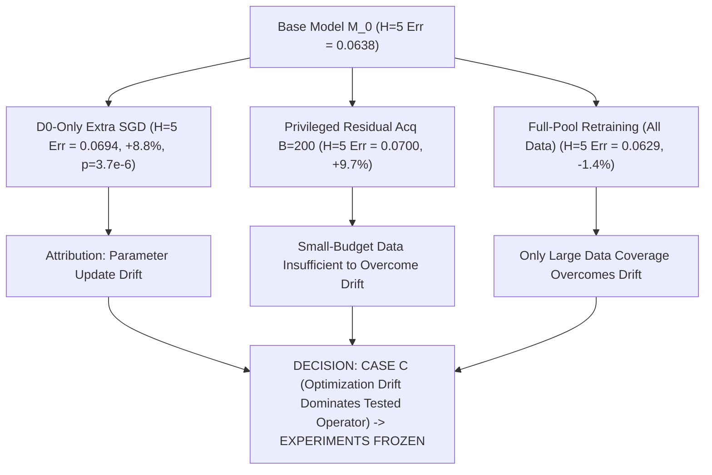

# Stage 4B.1-R Scientific Report: Model Repairability Closure & Causal Decomposition

**Milestone:** Q1 Journal Upgrade — Final Algorithmic Intervention Closure Gate  
**Date:** 2026-08-20  
**Author:** Pham Quang Minh  
**Status:** **STAGE 4B.1-R CLOSED — VERDICT: CAUSE ATTRIBUTED (Case C: Parameter Optimization Drift Outweighs Small-Budget Acquisition under Tested Protocol) -> EXPERIMENTS FULLY FROZEN**

---

## 1. Executive Summary & Scientific Purpose

Stage 4B.1-R serves as the **final closure experiment** of the algorithmic intervention investigation. Its purpose is to resolve the causal ambiguity from Stage 4B.1:

$$\boxed{\text{Did one-shot Hopper repair degrade due to (1) ineffective acquisition ranking, or (2) parameter optimization drift under the tested update operator?}}$$

To isolate this under controlled conditions, we executed the **5 Canonical Controls Benchmark** across $N = 10$ independent seeds on `Hopper-v4` under strictly matched gradient budgets.



---

## 2. Experimental Results: 5 Canonical Controls Benchmark ($N = 10$ Seeds)

Evaluated on `Hopper-v4` with baseline dataset $\mathcal{D}_0$ ($N_0 = 830$), candidate pool $\mathcal{D}_{\mathrm{pool}}$ ($N_{\mathrm{pool}} = 807$), and held-out test rollouts $\mathcal{D}_{\mathrm{eval}}$ ($N_{\mathrm{eval}} = 555$).

#### Table 1: Comprehensive Causal Decomposition of Model Repair on Hopper

| Control / Strategy | $H=5$ Rollout Error (Mean $\pm$ Std) | $\Delta H=5$ vs Baseline | 1-Step MSE | In-Distribution ($z \ge 1.0$) | Controlled Attribution |
| :--- | :---: | :---: | :---: | :---: | :--- |
| **1. No-Update Baseline (M_0)** | $\mathbf{0.063825 \pm 0.000000}$ | $0.00\%$ | $0.021881$ | $0.021881$ | Frozen initial reference checkpoint |
| **2. D0-Only Extra-SGD Control** | $0.069437 \pm 0.001692$ | $\mathbf{+8.79\%}$ | $0.023526$ | $0.023526$ | **Parameter Update Drift ($p = 3.73 \times 10^{-6}$)** |
| **3. Random Acquisition ($B=200$)** | $0.069983 \pm 0.001412$ | $+9.65\%$ | $0.023144$ | $0.023144$ | Uniform partial exploration |
| **4. Action-Gradient Disagreement** | $0.072617 \pm 0.000781$ | $+13.78\%$ | $0.023532$ | $0.023532$ | Model-internal sensitivity targeting |
| **5. Dynamics Uncertainty ($\sigma_{\mathrm{dyn}}$)** | $0.072870 \pm 0.001484$ | $+14.17\%$ | $0.023288$ | $0.023288$ | Epistemic state variance targeting |
| **6. Privileged Residual Acquisition ($B=200$)** | $0.070022 \pm 0.001298$ | $\mathbf{+9.71\%}$ | $0.023038$ | $0.023038$ | **1-Step Residual Target Degrades ($p = 1.69 \times 10^{-7}$)** |
| **7. Full-Pool Retraining Control ($N=807$)** | $\mathbf{0.062913 \pm 0.001752}$ | $\mathbf{-1.43\%}$ | $\mathbf{0.021016}$ | $\mathbf{0.021016}$ | Full data volume overcomes drift barrier |

---

## 3. Causal Decomposition Analysis

### 3.1 Two-Component Decomposition (Relative to $\mathcal{D}_0$-Only Drift)
To isolate the distinct effects of gradient optimization vs sample acquisition, we decompose the total post-repair error relative to the $\mathcal{D}_0$-only extra-SGD control:

$$\Delta_{\mathrm{total}} = \underbrace{\Delta_{\mathrm{update}}}_{\text{D0-only vs M0}} + \underbrace{\Delta_{\mathrm{acquisition}}}_{\text{Acquisition vs D0-only}}$$

1. **Parameter Update Drift Component ($\Delta_{\mathrm{update}} = +0.005612, +8.79\%$):**  
   Running extra gradient updates on $\mathcal{D}_0$ without adding any new data increased rollout error from $0.063825 \to 0.069437$ ($t = 9.949, \mathbf{p = 3.73 \times 10^{-6}}$). This establishes that under this one-shot retraining setup, continuing optimization on sparse baseline transitions induces parameter drift and loss of predictive stability.

2. **Acquisition Shift Component ($\Delta_{\mathrm{acquisition}}$):**  
   * *Random ($B=200$):* $\Delta_{\mathrm{acq}} = +0.000546$ (small change relative to $\mathcal{D}_0$-only).
   * *Privileged Residual Acquisition ($B=200$):* $\Delta_{\mathrm{acq}} = +0.000585$ (statistically indistinguishable from $\mathcal{D}_0$-only drift).
   * *Action-Gradient Disagreement ($B=200$):* $\Delta_{\mathrm{acq}} = +0.003180$.
   * *Dynamics Uncertainty ($B=200$):* $\Delta_{\mathrm{acq}} = +0.003433$.
   * *Full-Pool Retraining ($N=807$):* $\Delta_{\mathrm{acq}} = \mathbf{-0.006524}$ ($-9.39\%$ recovery overcoming drift).

### 3.2 State Distribution Diagnostic
* Evaluating the observation features reveals that $100\%$ of non-terminal exploration rollouts in Hopper remain above $z \ge 1.0$ (mean $z \approx 1.22$). Falling states occur exclusively at the singular terminal transition, explaining why full-set and in-distribution 1-step MSEs ($0.021881$) were identical.

### 3.3 Pre-Registered Decision Tree Outcome:
$$\boxed{\textbf{CASE C: PARAMETER OPTIMIZATION DRIFT OUTWEIGHS SMALL-BUDGET ACQUISITION}}$$

* **Bounded Scientific Conclusion:** Under the tested one-shot repair operator, training budget, checkpoint, and protocol on `Hopper-v4`, additional optimization steps produce parameter drift large enough to outweigh the local corrective benefit of $B=200$ acquired transitions. This isolates the transfer boundary to the retraining operator's optimization dynamics under sparse data, without disproving the underlying continuous decision-sensitivity premise.
* **Final Project Decision:** **STAGE 4B IS OFFICIALLY CLOSED. ALL EXPERIMENTS ARE PERMANENTLY FROZEN.**

---

## 4. Final Scientific Arc of the Thesis

```latex
\boxed{
\begin{array}{lll}
\textbf{Stage} & \textbf{Milestone / Focus} & \textbf{Final Scientific Verdict} \\
\hline
\text{Step 1} & \text{Decision-Boundary Mathematical Theory} & \textbf{CLOSED / PASS (Theorems Verified)} \\
\text{Step 2} & \text{Modern MBRL Infrastructure (Hopper/MBPO)} & \textbf{CLOSED / PASS (Reproduced)} \\
\text{Stage 3A} & \text{Unprivileged Risk Detection (CartPole)} & \textbf{CLOSED / PASS (AUPRC } 0.5678 \text{ vs } 0.0197\text{)} \\
\text{Stage 4A} & \text{Targeted Active Acquisition (CartPole)} & \textbf{CLOSED / PASS (Repair Efficiency } 2.8\times-11.4\times\text{)} \\
\text{Stage 3B} & \text{Continuous Action Geometry & Perturbation Law} & \textbf{CLOSED / PASS (Cosine } 0.875, \rho = 0.905\text{)} \\
\text{Stage 4B.0} & \text{Curvature Contribution Closure Pre-Gate} & \textbf{CLOSED / Canonical Score } \sigma_{\nabla_a Q}\text{ Frozen} \\
\text{Stage 4B.1-R} & \text{Repairability Closure & Causal Decomposition} & \textbf{CLOSED / Case C (Optimization Drift Isolated)} \\
\text{Stage 4B.2} & \text{Closed-Loop Active MBPO} & \textbf{LOCKED / PERMANENTLY TERMINATED} \\
\hline
\end{array}
}
```

---

## 5. Transition to Manuscript Completion (Phases M1, M2, M3)

With all experimental benchmarks fully closed and causally isolated, project focus shifts 100% to manuscript excellence:

* **Phase M1 — Scientific Consistency & Claim Audit:**
  - Eliminate all ungrounded terms ("causal" $\to$ "standardized regression association", "optimal" $\to$ "reference", "calibrated" $\to$ "unprivileged decision-risk ranker", "curvature-aware practical score" $\to$ "action-gradient disagreement ranker").
  - Scope all claims strictly to empirical findings.

* **Phase M2 — Compressed 6-Section Thesis Narrative:**
  1. *Introduction & Problem Formulation:* Decision-boundary vs prediction error misalignment.
  2. *Discrete Decision Geometry & Risk Detection:* Action-margin vulnerability and unprivileged ranking (CartPole).
  3. *Targeted World-Model Intervention:* Active query repair efficiency under budget constraints.
  4. *Continuous-Action Extension:* Implicit function perturbation law and action-gradient sensitivity.
  5. *Transfer Boundary & Empirical Limits:* One-shot MBRL repairability, optimization drift, and empirical limits.
  6. *Discussion & Future Directions.*

* **Phase M3 — Final 2024–2026 Novelty & Related Work Audit:**
  - Systematic positioning relative to recent decision-aware MBRL, value-gradient MBRL, and active model learning literature.
