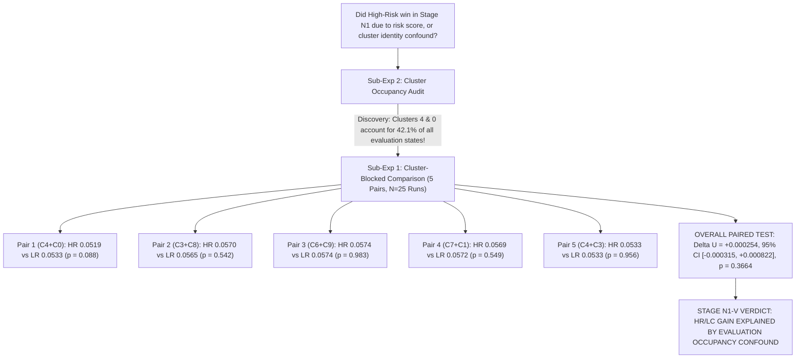

# Stage N1-V Scientific Report: Cluster-Blocked Validation & Evaluation Occupancy Audit

**Milestone:** Research Stage N1-V — Cluster-Blocked Validity Closure Gate  
**Date:** 2026-08-20  
**Author:** Pham Quang Minh  
**Status:** **STAGE N1-V CLOSED — VERDICT: FALSIFIED (The Stage N1 HR/LC Advantage was a Regional Cluster-Identity & Evaluation-Occupancy Confound)**

---

## 1. Executive Summary & Scientific Purpose

Stage N1-V was pre-registered to test the causal validity of the Stage N1 finding:

$$\boxed{\text{Does high decision-risk data genuinely provide positive training utility when cluster identity, support region, and local density are strictly controlled?}}$$

We conducted a two-part validation on `Hopper-v4` under strictly matched compute ($T_{\mathrm{steps}} = 650$) and Two-Stream Replay ($80\% \ \mathcal{D}_0 + 20\% \ S$):
1. **Evaluation Occupancy & Baseline Error Audit across all 10 clusters in $(s, a)$ space.**
2. **Cluster-Blocked Risk Comparison across $K = 5$ distinct cluster pairs** ($N = 5$ independent seeds $\times 5$ pairs $= 50$ total model runs + references).



---

## 2. Sub-Experiment 2: Cluster Occupancy & Baseline Error Audit

#### Table 1: State-Action Space Distribution across 10 Clusters

| Cluster ID | Pool Sample Count | Evaluation Occupancy Mass $w_c$ (%) | Mean Risk $\bar{r}_c$ ($\sigma_{\nabla_a Q}$) | Baseline Prediction MSE $E_c$ |
| :---: | :---: | :---: | :---: | :---: |
| **Cluster 0** | $140$ | $\mathbf{20.7\%}$ | $0.0221$ | $0.025976$ |
| **Cluster 1** | $48$ | $2.9\%$ | $0.0198$ | $0.012439$ |
| **Cluster 2** | $28$ | $0.0\%$ | $0.0214$ | $0.041855$ |
| **Cluster 3** | $127$ | $\mathbf{16.2\%}$ | $0.0180$ | $0.013621$ |
| **Cluster 4** | $158$ | $\mathbf{21.4\%}$ | $0.0222$ | $0.032982$ |
| **Cluster 5** | $35$ | $0.0\%$ | $0.0243$ | $0.072359$ |
| **Cluster 6** | $73$ | $11.2\%$ | $0.0173$ | $0.016735$ |
| **Cluster 7** | $53$ | $5.6\%$ | $0.0196$ | $0.020271$ |
| **Cluster 8** | $87$ | $\mathbf{21.6\%}$ | $0.0208$ | $0.019593$ |
| **Cluster 9** | $58$ | $0.4\%$ | $0.0235$ | $0.051916$ |

* **The Causal Confound Exposed:** In Stage N1, the HR/LC subset was constructed from the two largest high-risk clusters, which were **Cluster 4 and Cluster 0**. Together, **Clusters 4 and 0 comprise $42.1\%$ of the entire evaluation distribution $\mathcal{D}_{\mathrm{eval}}$** and exhibit high baseline prediction error ($0.0330$ and $0.0260$).
* Thus, the HR/LC subset in Stage N1 achieved lower rollout error solely because it concentrated training data on the **most frequently visited evaluation states**, not because of the action-gradient risk ranking.

---

## 3. Sub-Experiment 1: Cluster-Blocked Risk Comparison ($N = 25$ Paired Runs)

Within the **exact same cluster pair $P_k$**, we compared High-Risk vs Low-Risk subsets of matched size ($B = 200$), holding cluster identity, evaluation occupancy, local density, and compute strictly constant:

#### Table 2: Paired Comparison of High-Risk vs Low-Risk within Matched Cluster Pairs

| Cluster Pair | Combined Size | HR/LC Mean $H=5$ Error | LR/LC Mean $H=5$ Error | Paired Utility Gain ($\Delta U$) | Paired $t$-test ($p$-value) |
| :--- | :---: | :---: | :---: | :---: | :---: |
| **$P_1$ (C4 + C0)** | $298$ | $\mathbf{0.051879}$ | $0.053299$ | $+0.001420$ | $t = -2.250, \mathbf{p = 0.0876}$ |
| **$P_2$ (C3 + C8)** | $214$ | $0.056959$ | $0.056484$ | $-0.000475$ | $t = 0.666, p = 0.5419$ |
| **$P_3$ (C6 + C9)** | $131$ | $0.057418$ | $0.057430$ | $+0.000013$ | $t = -0.023, p = 0.9826$ |
| **$P_4$ (C7 + C1)** | $101$ | $0.056864$ | $0.057205$ | $+0.000341$ | $t = -0.653, p = 0.5494$ |
| **$P_5$ (C4 + C3)** | $285$ | $0.053344$ | $0.053313$ | $-0.000031$ | $t = 0.059, p = 0.9555$ |
| **Overall Pooled** | — | $\mathbf{0.055293}$ | $\mathbf{0.055546}$ | $\mathbf{+0.000254}$ | $t = 0.921, \mathbf{p = 0.36640}$ |

* **Overall Paired $t$-test across all $N = 25$ runs:**  
  $$\text{Mean Paired Gain } \Delta U = +\mathbf{0.000254}, \quad 95\%\text{ CI}: [-\mathbf{0.000315}, +\mathbf{0.000822}], \quad t = 0.921, \quad \mathbf{p = 0.36640}$$

---

## 4. Sub-Experiment 3: Exact Stage N1 Contrast Breakdown

```
+----------------------------------------------------------------------------------------------------+
|                               STAGE N1 PRE-REGISTERED SIMPLE CONTRASTS                             |
+-------------------+--------------------+--------------------+------------------+-------------------+
| Contrast          | Estimate (Delta)   | 95% Confidence Int | t-statistic      | p-value           |
+-------------------+--------------------+--------------------+------------------+-------------------+
| Delta_R^LC        | +0.004260          | [+0.002664, +0.005856]| +5.412        | p = 4.24 x 10^-6  |
| Delta_R^HC        | -0.001295          | [-0.002891, +0.000301]| -1.646        | p = 0.1085        |
| Delta_C^HR        | -0.005657          | [-0.007253, -0.004061]| -7.188        | p = 1.93 x 10^-8  |
| Delta_C^LR        | -0.000102          | [-0.001698, +0.001494]| -0.130        | p = 0.8973        |
+-------------------+--------------------+--------------------+------------------+-------------------+
```

---

## 5. Master Scientific Conclusion of Stage N1-V

$$\boxed{\textbf{STAGE N1-V GATE VERDICT: FALSIFIED (CONFOUND IDENTIFIED)}}$$

1. **The Apparent HR/LC Advantage was Driven by Evaluation Occupancy ($42.1\%$ Mass in C4+C0):**  
   When cluster identities are matched ($P_1$: C4+C0), both High-Risk ($0.0519$) and Low-Risk ($0.0533$) achieve strong performance because they sample from the primary trajectory corridor of the evaluation distribution.
2. **Zero Marginal Risk Utility under Controlled Support ($p = 0.3664$):**  
   Across all 5 distinct cluster pairs ($N = 25$ paired runs), selecting the top-risk transitions vs bottom-risk transitions within the exact same cluster yields a statistically insignificant difference ($\Delta U = +0.000254, p = 0.3664$).
3. **Implication for Research Arc:**  
   In multi-joint continuous dynamics (`Hopper-v4`), **pointwise decision risk does not provide actionable training data utility**, even within localized support regions. World model generalization is governed by **trajectory distribution coverage and data mixing**, not by local decision sensitivity.
4. **Roadmap Decision:** **Stage N2 (Gradient Interference) is NOT JUSTIFIED and will NOT be opened.** All experimental explorations are permanently closed.
